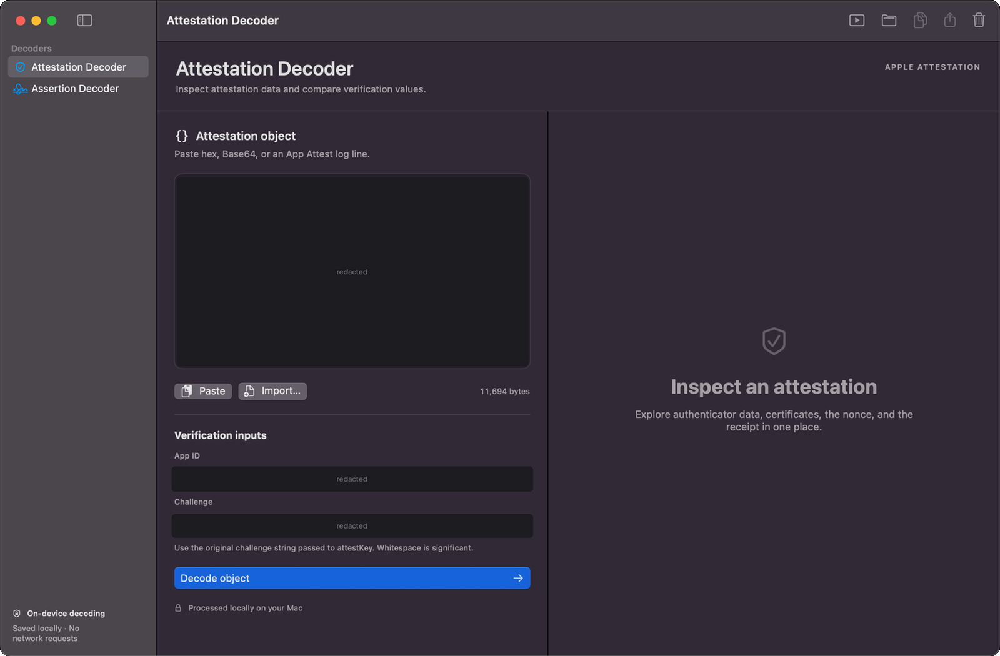
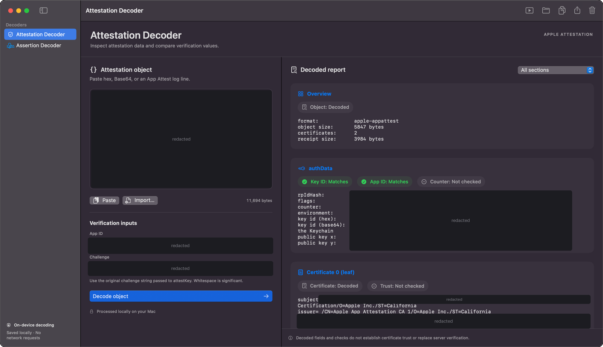
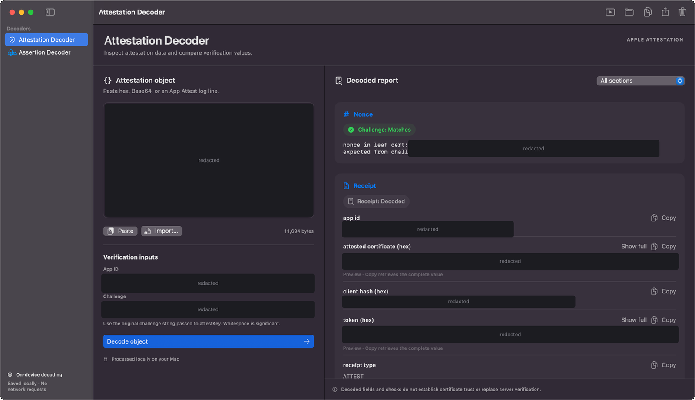
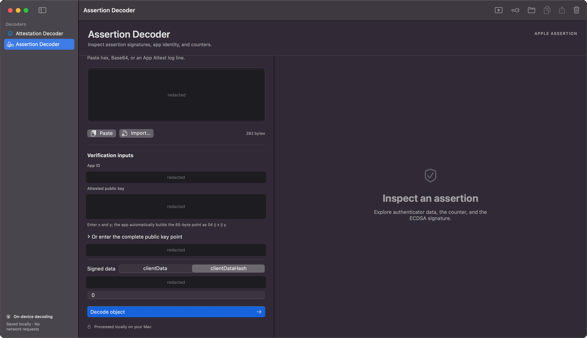
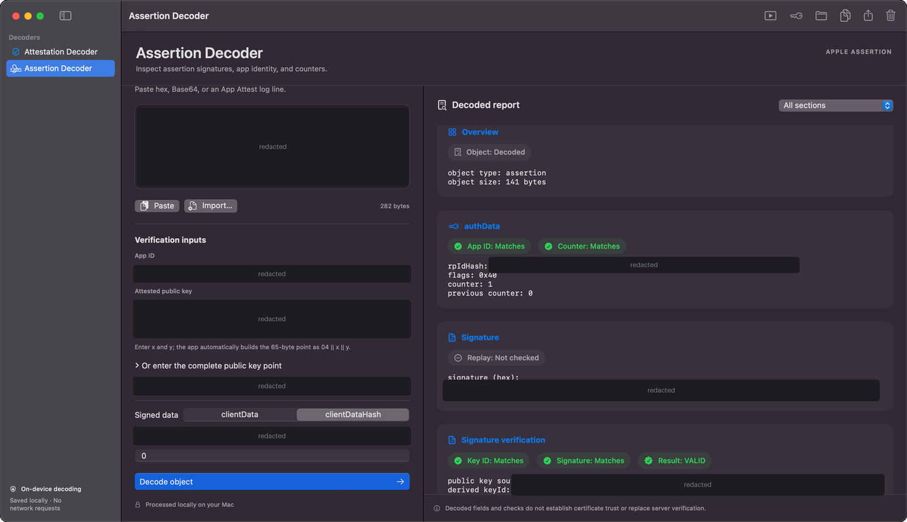
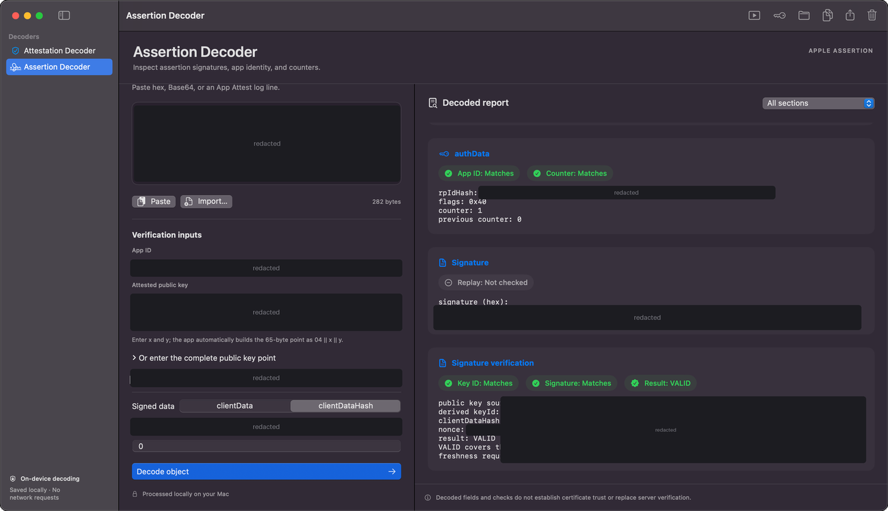

# App Attest Decoder

A local macOS inspector for Apple App Attest attestations and assertions. Find out **which value or verification check failed**, without sending your payloads to a third-party server.

- Inspect authenticator data, certificates, nonces, and receipt fields.
- Verify assertion signatures with CryptoKit and see Key ID, App ID, and counter checks.
- Enter public key x/y coordinates; the app builds `04 || x || y` automatically.
- Compare exact signed clientData or supply clientDataHash directly.
- Copy complete receipt fields and export reports.
- Keep independent drafts locally with SwiftData, with a shared App ID.
- Explore a known-valid example without changing your saved inputs.

## Screenshots

Values from the device and app are redacted in these screenshots.

### Attestation Decoder

**Input**



**Decoded report**



**Nonce and receipt**



### Assertion Decoder

**Input**



**Decoded report**



**Signature verification**



## App Attest guide

[App Attest Verification Guide (PDF)](docs/App_Attest_Verification_Guide.pdf) explains the complete App Attest flow: key generation, attestation, server-side validation, assertions, fraud-risk assessment, and rollout practices.

## Getting started

**Requirements:** a Mac with **Xcode 26+** (Swift 6.2+), Apple's Python 3 at `/usr/bin/python3`, and the system `openssl`. The app targets **macOS 14+**. No Apple Developer account, signing team, or provisioning profile is needed, and there are no third-party dependencies.

```sh
git clone https://github.com/shankarmadeshvaran/app-attest-decoder.git
cd app-attest-decoder
open AppAttestDecoder.xcodeproj
```

1. Select the **AppAttestDecoder** scheme and **My Mac** as the run destination.
2. Press **⌘R**. The app opens as **App Attest Decoder**.

The project signs locally ("Sign to Run Locally") and is not notarized. The app is not sandboxed because it runs Apple's `/usr/bin/python3` to decode attestation objects.

The same sources also open as a Swift package: `open Package.swift`, then select the **AppAttestDecoder** scheme and press ⌘R.

## Try it

Click **Try example** in the toolbar. Its signature report should show **VALID**, counter **1**, and:

```text
clientDataHash: 3800ee016bc6ba2c6e7ccb1aaa5eca0f958bc7ee014ee965ee55b64685ffaa63
nonce: 9a1f2f01c5e17c67bc508668638feb41fd4872c3bbad442d2bcb24ced50e4a0f
```

The example is entirely synthetic. Its complete inputs are in [assertion-example.json](Sources/AppAttestDecoder/Resources/assertion-example.json). No private key is included or needed.

## Decode an attestation

In your iOS app, `DCAppAttestService.attestKey(_:clientDataHash:completionHandler:)` returns the attestation object as `Data`. Log or copy it as hex or Base64, for example `attestationObject.base64EncodedString()`, together with the challenge string you hashed into `clientDataHash`.

1. Choose **Attestation Decoder**.
2. Paste hex or Base64, or import a UTF-8 text file containing it.
3. Optionally enter your app identifier as `TeamID.BundleID` (for example `ABCDE12345.com.example.app`) and the original UTF-8 attestation challenge.
4. Choose **Decode object** (⌘↩).
5. Review the checks: **app id matches rpIdHash** confirms the App ID, **nonce matches challenge** confirms the challenge, and **key id = SHA256(public key)** confirms the credential key.

The report includes authenticator fields, certificate descriptions, nonce comparison, and receipt fields. Binary receipt values use hex. Each receipt field has a copy action; long values expand with **Show full**. Exported reports contain complete values.

The last decoded attestation's COSE public key is saved locally. In Assertion Decoder, **Use attestation key** loads its x/y coordinates and derived Key ID. This extraction does not establish certificate trust.

## Verify an assertion

1. Choose **Assertion Decoder** and paste the assertion as hex or Base64.
2. Enter **x and y**, each 32 bytes of hex. The app automatically prepends `04`. Alternatively leave x/y empty and enter the complete 65-byte point.
3. Enter the Base64 **Key ID**, which is checked against SHA256(public key point). A Key ID is a hash, not a public key; a mismatch stops verification.
4. Enter the signed **clientData** in this tool's five-line format, or select **clientDataHash** and enter exactly 64 hex characters.
5. Optionally supply App ID and a previous UInt32 counter, then decode.

The five-line format is:

```text
METHOD
/path?query
lowercase-hex-SHA256-of-body
timestamp
nonce
```

Use LF separators and **no trailing newline**. Bytes are preserved exactly. If your app signs JSON, binary data, a challenge alone, or another layout, calculate SHA256 of those exact bytes in your application and use **clientDataHash** instead. Never reserialize JSON to guess the original bytes.

The native CBOR parser requires exactly two unique byte-string entries (`signature`, `authenticatorData`), exactly 37 authenticator bytes, and no trailing data. The verifier computes `nonce = SHA256(authenticatorData || clientDataHash)` and passes nonce as **Data** to CryptoKit's message overload of `isValidSignature`, selecting ECDSA-SHA256 over nonce. The supplied known-valid vector covers this behavior.

## What VALID means

**VALID is a diagnostic result for the supplied inputs, not a complete server authentication decision.** The app checks the supplied key, signature, and requested comparisons. It does not establish Apple certificate-chain trust, key provenance, challenge freshness, or server-side replay protection. Additional assertion extension layouts are not supported. Attestation receipts are decoded using OpenSSL `-noverify` and are not presented as trusted evidence.

## Development

```sh
./script/test.sh                          # Assertion, persistence, and Python decoder tests
python3 script/generate_xcodeproj.py .    # Regenerate the Xcode project after adding, removing, or renaming files
```

Tests cover a synthetic known-valid assertion vector and negative cases, strict CBOR/DER handling, full receipt values, persistence across separate processes, draft independence, and clear behavior. GitHub Actions runs the tests, builds the Xcode project, and checks that the project file is up to date.

The attestation decoder the app bundles can also be run directly: `python3 Sources/AppAttestDecoder/Resources/appattest_decode.py --help`.

## License

[MIT](LICENSE). This is an independent project and is not affiliated with Apple.

The Apple diagrams in the App Attest guide are © Apple Inc., taken from Apple's App Attest documentation and WWDC material for reference, and are not covered by this repository's license.
